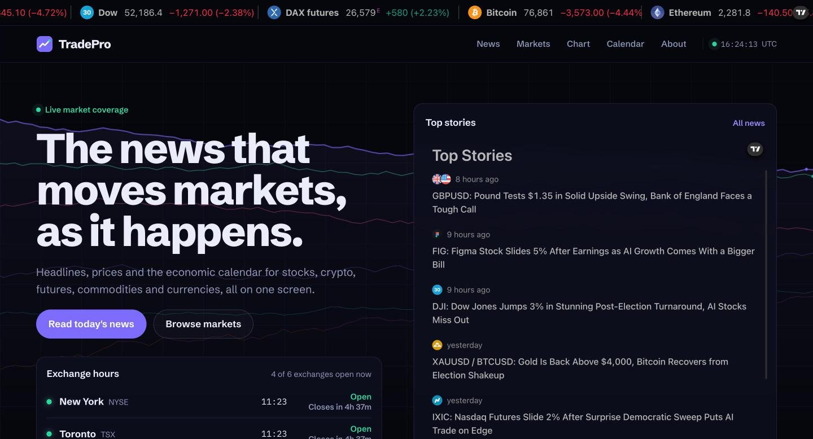
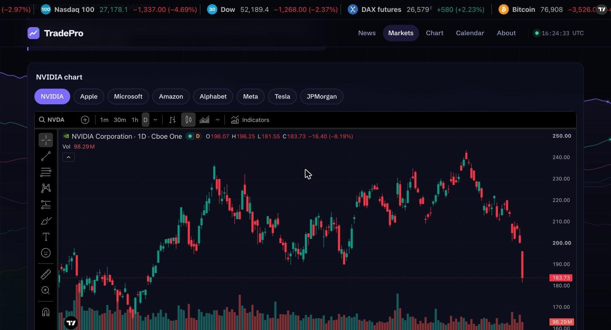
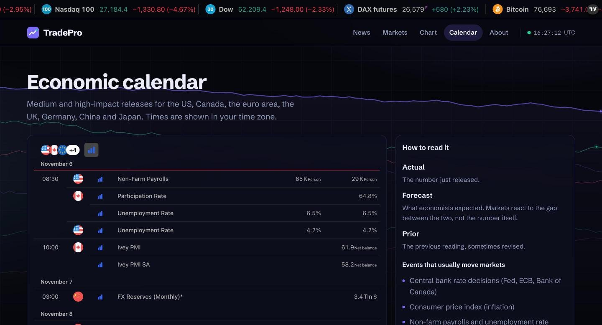

# TradePro

**A real-time market news portal: the headlines, prices and events that move stocks, crypto, futures, commodities and currencies, on one screen.**

TradePro collects the top market stories, live quotes, interactive charts, heatmaps and the economic calendar in a single fast, static site. All live data comes from [TradingView](https://www.tradingview.com/)'s public widgets, embedded in sandboxed iframes, so the site needs no API keys, no backend and no user accounts.

🔗 **Live site:** https://hsoja.github.io/TradePro/

> 📰 TradePro is an information site, not a trading platform. It doesn't hold money, place orders or give financial advice.



## Features

- 📰 **Market news**: TradingView's top stories across every market, shown next to the economic events scheduled to move prices.
- 📈 **Live prices** in a scrolling ticker, a multi-asset market snapshot and per-market quote boards.
- 🕯️ **Interactive charts**: a full TradingView chart on every market page, with one-click symbol switching and search for any ticker.
- 🗺️ **Heatmaps** for the S&P 500 and crypto, top US movers and forex cross rates.
- 🗓️ **Economic calendar** filtered to the medium and high-impact releases that move markets.
- 🕐 **Exchange hours board** showing which of six major exchanges are open now, computed in the browser for each time zone.
- ✨ **Animated background** of drifting price lines (lightweight canvas, paused in background tabs, still when reduced motion is on).
- 🔐 **Private by design**: no accounts, forms, cookies or analytics; strict Content Security Policy; widgets isolated from the page.

| Market page | Economic calendar |
| --- | --- |
|  |  |

## Tech stack

| Layer | Technologies |
| --- | --- |
| Framework | [Astro](https://astro.build/) 7 (static output), TypeScript |
| Live data | TradingView embed widgets (news timeline, advanced chart, market overview, quotes, heatmaps, hotlists, economic calendar, ticker tape) |
| Styling | Hand-written CSS design system, self-hosted Schibsted Grotesk and IBM Plex Mono fonts |
| Animation | HTML canvas 2D, no libraries |
| Testing & QA | Vitest (40 tests), post-build security scanner, npm audit, Gitleaks |
| CI/CD | GitHub Actions with pinned action SHAs and read-only permissions, Dependabot, GitHub Pages |

## Project structure

```
TradePro/
├── src/
│   ├── components/        Reusable UI: TvWidget (sandboxed TradingView iframe), SessionBoard, Logo
│   ├── data/markets.ts    Markets, symbols, ticker tape and exchange hours (single source of truth)
│   ├── layouts/Base.astro Page shell: CSP, ticker tape, header, footer, background canvas
│   ├── lib/
│   │   ├── tradingview.ts Allow-listed widget URL builder with symbol validation
│   │   ├── security.ts    Content Security Policy shared by the meta tag and _headers
│   │   ├── sessions.ts    Exchange open/closed logic (pure, unit-tested)
│   │   └── url.ts         Base-path aware links (for GitHub Pages)
│   ├── pages/             index, news, markets/ (index + [slug]), chart, calendar, about, legal, 404
│   ├── scripts/           app.ts (tabs, chart switcher, clock, sessions) and trend-field.ts (background)
│   └── styles/global.css  Design tokens and all styles
├── public/                favicon, robots.txt, _headers (security headers for Cloudflare/Netlify)
├── tests/                 Vitest suites: widget URLs, market data, sessions, security configuration
├── scripts/               check-dist.mjs (post-build security scan), scan_exposed_files.sh
├── docs/                  Architecture, security model, deployment guide, screenshots
├── .github/               CI security pipeline, Pages deployment, Dependabot
└── SECURITY_REPORT.md     Latest audit results and findings
```

How the pieces fit together is explained in [docs/ARCHITECTURE.md](docs/ARCHITECTURE.md).

## Run it locally

**Requirements:** Node.js 22.12 or newer.

```bash
git clone https://github.com/Hsoja/TradePro.git
cd TradePro
npm ci
npm run dev        # http://localhost:4321
```

No `.env` file or API keys are needed.

| Command | What it does |
| --- | --- |
| `npm run dev` | Development server with hot reload |
| `npm run build` | Production build in `dist/` |
| `npm run preview` | Serve the production build locally |
| `npm test` | Run the Vitest suite |
| `npm run check:dist` | Scan the build for inline code, unexpected third parties and secrets |
| `npm run verify` | All of the above in order |

## Security

- **No third-party code on the page.** TradingView widgets are built as plain iframe URLs from an allow-list of widget types and validated symbols, instead of loading TradingView's loader script. Each iframe is cross-origin and sandboxed, so it can't read or change TradePro.
- **Strict CSP**: `script-src 'self'`, `style-src 'self'`, `frame-src` limited to TradingView's widget host, `form-action 'none'`, no inline code anywhere (enforced by a build check).
- **Security headers** (`public/_headers`): HSTS, `X-Frame-Options: DENY`, `frame-ancestors 'none'`, `nosniff`, Referrer and Permissions policies.
- **No personal data**: no accounts, forms, cookies, analytics or local storage. Fonts are self-hosted.
- **Supply chain**: two runtime dependencies (Astro and fonts), no install scripts, `npm audit` and Gitleaks in CI, Dependabot updates.

Details: [docs/SECURITY.md](docs/SECURITY.md) and [SECURITY_REPORT.md](SECURITY_REPORT.md).

## Documentation

- [Architecture](docs/ARCHITECTURE.md): pages, components, data flow and design decisions
- [Security model](docs/SECURITY.md): threats, controls and how to report a vulnerability
- [Deployment](docs/DEPLOYMENT.md): GitHub Pages, Cloudflare Pages and Netlify
- [Security report](SECURITY_REPORT.md): latest audit results

## Data and attribution

Market data, charts and news are provided by TradingView and may be delayed. Futures traded on US exchanges (CME Group) aren't available in free widgets, so the futures page shows 24-hour CFDs that track the S&P 500, Nasdaq 100 and Dow, alongside Eurex DAX futures.

## What I learned

Embedding third-party content without trusting it, designing a strict Content Security Policy for a static site, writing build-time checks that fail the pipeline on unsafe output, and building a data-dense dark interface that stays readable and accessible.

## Author

**Katherine Mauricio Gonzalez**, Software Engineering student at Conestoga College, Waterloo, ON.
